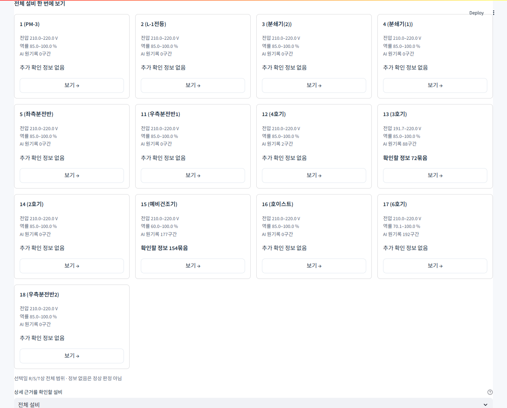

# 센서 확인 정보와 대시보드 개선 — 팀 검토 보고서

2026-10-16 · 마가렛트 · `codex/sensor-insights-team-review-20261016`

## 이번에 해결한 문제

기존 AI 탐지는 작은 편차도 기록하므로 원기록을 모두 같은 중요도로 보여주면 사용자가 무엇부터 확인해야 할지 판단하기 어려웠습니다. 화면의 설명도 길어 설비와 작업을 찾기 어려웠습니다.

이번 버전은 **모델과 탐지 기록을 유지한 채, 확인할 센서 변화와 상세 기록을 분리**했습니다. 13대 설비를 한눈에 보고 근거·보고서로 이동하도록 복원했으며, 긴 설명은 시작 가이드에 모았습니다. 새 모델을 학습하거나 고장 탐지 성능을 개선했다고 주장하는 변경은 아닙니다.

| 변경 전 | 변경 후 |
|---|---|
| 탐지 건수와 설명을 먼저 읽어야 함 | 전체 설비와 확인 정보부터 보고 필요할 때 가이드 확인 |
| 전체 설비 개요가 일부 요약에 가려짐 | 13대 카드를 모두 표시하고 상세 선택 후에도 유지 |
| AI 기록과 점검할 내용의 구분이 어려움 | 확인할 정보 / AI 원기록 / 기록만 보관을 구분 |
| 같은 유형의 반복 기록이 많음 | 같은 설비·상·유형·방향의 반복을 묶어 표시 |
| 화면과 보고서의 대상·기준 혼동 가능 | 초안 생성 시 날짜·설비·기준·근거 고정 |

## 화면 미리보기



긴 설명은 시작 가이드에서 확인하고, 점검 화면에서는 수치·설비·상세 기록에 집중합니다.

## 사용자 흐름

**전체 설비 확인 → 대상 설비 보기 → 센서 변화와 AI 근거 확인 → 보고서 작성 → 담당자 확인 → Excel 다운로드**

기본 검토일은 2025-04-29입니다. 3호기와 예비건조기에서 확인 정보의 예를 볼 수 있습니다. 상세 설비를 골라도 전체 13대 카드는 유지됩니다. **기준·집계 설명** 버튼은 시작 가이드로 연결됩니다. 정보가 없는 설비는 “추가 확인 정보 없음”으로 표시하고 정상·무고장으로 확정하지 않습니다.

## AI와 센서 조건의 역할

1. 기존 Isolation Forest가 남긴 `ai_flag`와 점수를 그대로 읽습니다. 모델 파일·설비별 기준점수·원래 라벨을 바꾸지 않았습니다. AI 판정은 설비 단위이며 특정 상의 고장 원인을 확정하지 않습니다.
2. 같은 설비·같은 상의 5초 센서값으로 아래 변화 조건을 계산합니다.
3. 판단 시점까지 해당 센서 조건 구간 안에 **기존 AI 양성 근거가 있는 경우** 확인 정보를 만듭니다.
4. 조건에 맞지 않는 AI 기록도 남겨 조회·CSV·보고서 전체 내역에서 확인합니다.

지속 시간은 센서 조건이 이어진 시간입니다. 중간에 AI 음성 표본이 있어도 센서 조건이 이어지면 시간에 포함합니다. 반대로 센서 정상 복귀·누락·날짜 경계는 연속을 끊습니다. AI가 끝까지 탐지하지 않은 센서 조건은 새 확인 정보에 포함하지 않으므로, 이것을 독립 안전 경보로 해석하면 안 됩니다. 기존 설정 기준 결과는 별도 전체 탐지 기록에 남아 있습니다.

## 적용한 과제용 기본값

| 항목 | 측정 조건 | 정보 생성 시점 |
|---|---|---|
| 큰 전압 이탈 | R/S/T 중 해당 상전압이 198V 미만 또는 242V 초과 | 조건과 AI 근거가 있는 5초 표본 관측 완료 후 |
| 전압 이탈 지속 | 해당 상전압 207V 미만 또는 233V 초과가 60초 연속 | 지속 시간과 AI 근거가 모두 확보된 때 |
| 역률 급락 | 해당 상의 역률 70% 미만이고 기준선보다 20%p 이상 하락 | 조건과 AI 근거가 확보된 표본 관측 완료 후 |
| 낮은 역률 지속 | 해당 상의 역률 80% 미만이 180초 연속 | 지속 시간과 AI 근거가 모두 확보된 때 |

- 역률 기준선은 **급락 구간 시작 전 300초의 중앙값**입니다. 같은 설비·같은 상의 연속 유효 표본 60개를 사용하며 현재 값은 제외하고, 구간 동안 고정합니다. 20%p는 상대 변화율 20%와 다릅니다.
- 과거 기준선이 충분하지 않으면 역률 급락을 판정하지 않습니다. 다른 조건과 AI 원기록은 유지합니다.
- 전압은 정격 220V를 가정한 시작값입니다. 설비 정격·허용 범위·실제 고장 자료로 검증되지 않았습니다.
- 사용자 설정은 새 확인 정보 계산에만 적용되며 기존 AI 판정을 바꾸지 않습니다.

표본 종료 시각 이후에만 조건을 판단합니다. 예를 들어 00:00:00 표본의 관측은 00:00:05에 완료됩니다. 나중에 관측한 최저값·최고값을 사용해 과거 시점에 정보가 발생했다고 만들지 않습니다. 현재 체험의 계산 시점은 `dashboard_data.NOW`인 2025-04-30 00:00입니다.

## 한 구간과 한 묶음의 차이

| 단위 | 의미 |
|---|---|
| AI 표본 | 기존 모델이 탐지한 5초 기록 한 개 |
| AI 구간 | 같은 설비에서 연속된 AI 표본을 묶은 기록 |
| 센서 정보 구간 | 같은 설비·상·조건이 연속되고 AI 근거가 연결된 확인 정보 |
| 표시 묶음 | 같은 설비·상·유형·방향에서 반복된 센서 정보를 모은 화면 단위 |

한 센서 조건이 이어지는 동안 매 5초마다 새 정보를 만들지 않습니다. 기본 묶음 간격은 10분이며, 앞선 정보와의 간격이 10분 미만이면 같은 묶음에 포함합니다. 정확히 10분 이상이면 새 묶음입니다. 관측 누락·날짜 경계는 별도로 나눕니다.

묶음의 처음~마지막 시각은 연속 이상 시간이나 정상 복귀 판정이 아닙니다. 위 단위들은 모두 실제 고장 건수와 다릅니다. 메일·푸시 알림을 발송하거나 설비를 제어하지 않습니다.

## 4월 29일 기본값으로 확인한 결과

| 항목 | 결과 |
|---|---:|
| 보존된 기존 AI 표본 | 461개 |
| 보존된 기존 AI 구간 | 459개 |
| 조건에 맞는 센서 정보 구간 | 439개 |
| 화면 표시 묶음 | 226개 |
| 확인 정보가 있는 설비 | 2대 / 전체 13대 |

| 설비 | 센서 정보 구간 | 표시 묶음 |
|---|---:|---:|
| 3호기 | 91개 | 72개 |
| 예비건조기 | 348개 | 154개 |

이 날짜에서는 큰 전압 이탈 91구간, 역률 급락 348구간이며 지속 조건의 결과는 0구간입니다. AI는 설비 단위, 센서 정보는 상·유형 단위이므로 **459→226을 감소율로 계산하거나 정밀도 개선으로 표현하지 않습니다.** 226묶음 역시 실제 사용자에게 많은지 팀 검토가 필요합니다.

원모델 파일 해시(SHA-256): `54c232d430dd316c2bf878b7727f52a84ce75c571f993e1f4db7f4da061dafb6`.

## 보고서와 에이전트

새 보고서는 생성 시 날짜·설비·정책·센서 정보·근거를 복사해 고정합니다. 화면 선택이나 설정을 바꿔도 작성 중 초안을 바꾸지 않고, 새 보고서 시작으로 적용합니다. 구버전 초안은 당시의 근거를 유지합니다.

Excel에는 `센서 점검 정보`, `센서 정보 묶음` 별첨과 기존 설정 기준·AI 전체 내역을 보존합니다. 최초 판단 시점의 근거와 이후 관측을 포함한 최저·최고값을 구분합니다. 에이전트도 동일한 집계를 읽으며, 정보 묶음을 고장 건수나 모델 점수를 고장 확률로 설명하지 않도록 했습니다.

자동 테스트는 실제 OpenAI API를 호출하지 않습니다. 팀 환경에서 GPT 대화를 확인하려면 키를 별도로 설정해야 합니다.

## 실행과 자료 범위

실행 명령은 [루트 README](../README.md#실행)에 있습니다. `ml/outputs/agent_data/`에 팀원 검토용 캐시가 포함됩니다.

| 자료 | 파일 | 범위·용도 |
|---|---|---|
| 실측 요약 | `dashboard_hourly.parquet/.json` | 12월~4월 설비·시간별 요약 |
| 전력 예측 | `dashboard_forecast.parquet/.json` | 4월 30일~5월 31일 예측 |
| 기존 탐지 구간 | `alert_events.parquet/.json` | 4월 1~29일 설정 기준·AI 구간 |
| 이전 정책용 AI 표본 | `ai_notification_samples.parquet/.json` | 기존 AI 기록과 점수 보존 |
| 기본 센서 확인 정보 | `sensor_insights/manifest.json`, `YYYY-MM-DD.json.gz` | 4월 1~29일 기본 정책의 날짜 전체 결과 |

원자료 없는 환경에서는 기본 정책 결과로 전체 카드·AI 원기록·센서 정보·보고서를 확인합니다. 기준 변경이나 선택일 중간 시점 재계산에는 **검증된 5초 원자료 캐시**가 필요하며, 자료 없이 기본값을 변경값 결과처럼 대신 보여주지 않습니다. 자료·캐시 검증 실패는 확인 불가이고 0건이 아닙니다.

원자료 캐시의 기본 위치는 저장소 상위 `outputs/agent_data`입니다. 다른 위치는 `MARGARET_SENSOR_CACHE`로 지정합니다. 기본 센서 결과를 다시 생성할 때만 다음을 실행합니다.

```powershell
python tools/prepare_sensor_insight_cache.py
```

생성에는 검증된 원자료 캐시와 모델 출처 검증 자료가 필요합니다. 배포용 결과는 파일 해시·정책·자료 시점을 검증합니다. 포함된 캐시는 과거 데이터의 조회 결과이며, 앞으로 수신되는 센서를 처리하는 실시간 수집 기능은 아닙니다.

## 검증 범위와 남은 일

계산 테스트는 경계값, 5초 표본 완료 시점, 연속·누락·날짜 분리, 과거 기준선, 원기록 보존을 확인합니다. 화면과 보고서 테스트는 전체 설비 유지, 자료 없음, 설정 적용, 초안 보호, 동일 근거 출력을 확인합니다. 최종 검증에서는 원본 데이터·개인 설정을 복사하지 않은 별도 작업본에서 **172개 테스트가 통과**했습니다. PC·모바일·어두운 화면을 확인했고, 기본 캐시만 있는 브라우저에서 13대 카드, AI 459구간·정보 226묶음, 변경 기준 입력 잠금, 3호기 보고서의 91구간·72묶음 연결을 확인했습니다.

실제 고장 정답과 현장 확인이 없으므로 고장 정밀도·재현율을 입증하지 못했습니다. 여러 번 본 4월은 개발 재평가 자료입니다. 다음 단계는 팀의 화면·양식 검토, 설비 정격과 담당자 판단 수집, 새 기간 자료 확보 순서입니다. 팀 검토 후 별도 병합·배포 절차를 진행합니다.
