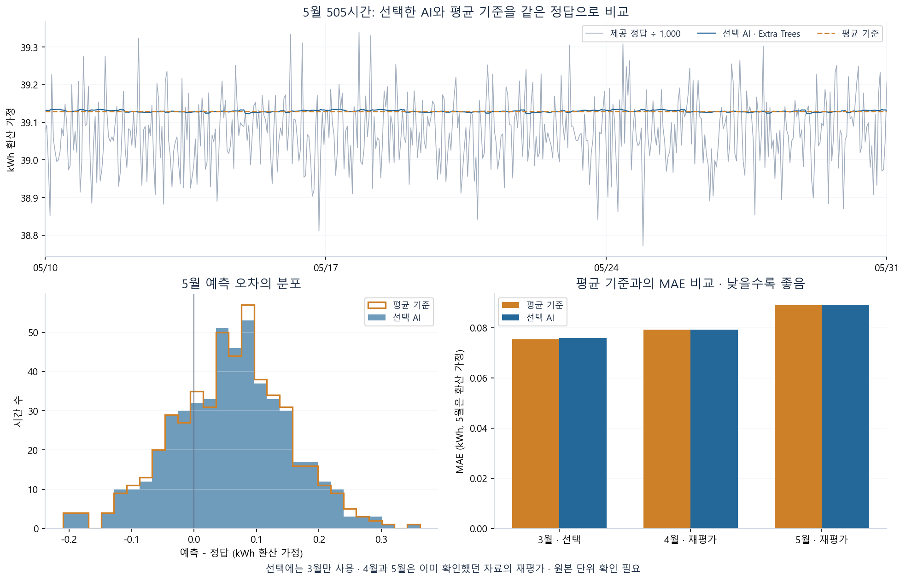
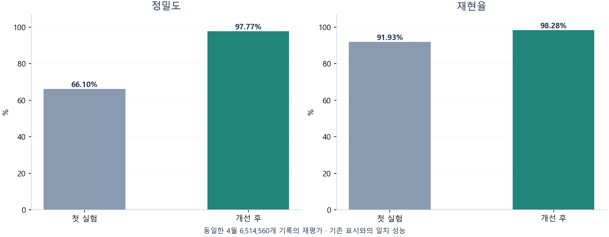

# 모델 결과와 해석

## 전력·요금·탄소 예측 · AI 모델 비교

최종 모델은 **Extra Trees** (`extra_trees_3`)입니다. XGBoost, Random Forest, Extra Trees, HistGradientBoosting을 각각 3개 설정으로 비교했습니다. **3월 공장 전체 MAE가 가장 작은 AI 후보**를 선택했고, 평균·중앙값은 성능 비교 기준으로만 사용했습니다. 이는 과제에서 AI 모델을 사용한다는 요구를 반영한 선택 조건입니다.

| 모델 | 3월 선택 MAE (kWh) | 4월 재평가 MAE (kWh) | 5월 재평가 MAE (kWh 환산 가정) | 5월 정규화 MAE |
|---|---:|---:|---:|---:|
| XGBoost | 0.076079 | 0.079097 | 0.089908 | 0.2301% |
| Random Forest | 0.076019 | 0.079523 | 0.088967 | 0.2277% |
| Extra Trees · 최종 선택 | 0.075885 | 0.079246 | 0.089132 | 0.2281% |
| HistGradientBoosting | 0.076706 | 0.079705 | 0.089898 | 0.2301% |
| 평균 (비교 기준) | 0.075431 | 0.079182 | 0.089031 | 0.2279% |
| 중앙값 (비교 기준) | 0.075524 | 0.079147 | 0.089851 | 0.2300% |

AI 모델별 행은 **3월에 고른 해당 모델군의 대표 설정**입니다. 5월에 가장 좋은 모델로 다시 바꾸지 않았습니다. 평균 기준보다 오차가 0.113% 크므로 평균 대비 개선을 달성하지 못했습니다. 공장 전력량 변동이 작은 데이터에서 복잡한 모델이 자동으로 유리한 것은 아닙니다.

5월 선택 모델의 정답 원본 수치 MAE는 **89.131948**입니다. 표의 5월 kWh는 제공 정답의 `hourly_pow`를 Wh로 해석해 1,000으로 나눈 조건부 값입니다. MAE는 평균 절대 오차이고, 정규화 MAE는 MAE를 실제 평균으로 나눈 비율입니다. 분류 정확도가 아닙니다.

1. 12월~2월 학습 → 3월 10일 00:00~31일 00:00의 505시간으로 AI 후보 선택.
2. 선택·설정 고정 → 12월~3월로 학습해 4월 10~29일 480시간 재평가.
3. 12월~4월 완전한 시간 집계로 최종 학습 → 모델·5월 예측 저장 → 5월 정답과 비교.
4. 5월 평가 구간: 2025-05-10 00:00~05-31 00:00, 끝 시각 포함 505시간, 13개 설비.

**4월·5월은 이전 실험에서 이미 확인했으므로 이번 결과는 재평가입니다.** 이번 실행에서 정답을 읽기 전에 선택과 모델을 고정했어도 새 미사용 데이터의 독립 검증이 되지는 않습니다. 사용 입력은 시간·요일·주말 여부·설비 구분이며 미래 전력 실측, 센서 값, 5월 정답을 학습 입력으로 사용하지 않았습니다.

전력량에서 요금과 탄소를 고정 계수로 계산합니다. 물리적 출력은 180원/kWh와 0.424kgCO₂/kWh를 적용합니다. 단위 충돌은 [데이터 규격](DATA_CONTRACT.md)을 확인하세요. 오차 1% 이내 같은 목표는 내부 제안 기준이며 과제의 공식 합격 기준이 아닙니다.

[모델군 비교](../outputs/forecast_v2/comparison.csv) · [12개 AI 설정과 기준 모델](../outputs/forecast_v2/march_candidates.csv) · [선택 기록](../outputs/forecast_v2/selection.json) · [최종 모델 고정 기록](../outputs/forecast_v2/model_freeze.json)

`outputs/forecast/`와 `models/forecast/`는 첫 실험의 보존본입니다. 현재 기본값은 `forecast_v2/`이며, 첫 실험의 평균 예측 결과를 현재 AI 모델의 결과로 표시하지 않습니다.

## 이상탐지 개선

선택 모델은 **전압·역률 6개 입력 Isolation Forest**입니다. 설비별로 12월~2월 센서 표본 51,000행을 학습했습니다. 전력·전류를 제거하고 경고 기준을 다시 정한 결과입니다.

| 4월 전체 재평가 | 정밀도 | 재현율 | 오탐 기록 | 누락 기록 |
|---|---:|---:|---:|---:|
| 첫 실험 IF | 66.10% | 91.93% | 5,964 | 1,021 |
| 기존 IF 경고 기준 조정 | 93.35% | 91.78% | 827 | 1,040 |
| **전압·역률 IF · 선택** | **97.77%** | **98.28%** | **283** | **217** |
| 통계거리 비교 | 97.08% | 94.45% | 359 | 702 |

모든 13개 설비, 4월 1~29일의 **6,514,560개 기록**을 포함했습니다. 표의 개수는 5초 기록 수이며 독립적인 고장 사건 수가 아닙니다. 목표였던 정밀도 70%·재현율 80%는 실험용 제안 기준이며 공식 합격 기준이 아닙니다.

시간 분리는 다음과 같습니다.

1. 12월~2월: 점수 모델 학습. 이상치 표시를 입력하지 않습니다.
2. 3월 1~15일: 기존 표시를 활용해 경고 기준 조정.
3. 3월 16~31일: 후보 12개 비교·선택.
4. 모델·기준·선택 내역 저장 후 4월 전수 재평가.

**중요: 4월 오류를 이미 보고 개선 방향을 정했으므로 4월은 독립적인 최종 시험이 아닙니다.** 학습 함수에 직접 4월을 넣지 않았더라도 설계에 영향을 줬습니다. 새 미사용 센서 데이터의 성능은 아직 확인하지 못했습니다.

## 이상 표시의 의미

강의자료에는 상전압 중 하나라도 210V 미만이거나 역률 중 하나라도 85% 미만이면 `is_outlier`로 표시하도록 되어 있습니다. 이 규칙은 3월 표본 130만 행과 4월 전체의 표시·종류와 모두 일치했습니다.

근거: 제공 강의자료 `2일차/session-02_데이터 전처리 기초.pdf` 14·23쪽, `session-04_전처리 코드 구현.pdf` 17·19쪽. 정확한 원본 파일명과 점검 내역은 [표시 감사 결과](../outputs/anomaly_v2/label_audit.json)에 있습니다. 강의 PDF 자체는 포함하지 않았습니다.

따라서 위 성능은 **교육용 규칙 표시와의 일치 정도**입니다. 실제 고장 확인 기록이나 최초 삽입 이상치의 독립 정답을 검증한 것이 아닙니다. 동일 규칙을 적용하면 감사 범위에서 표시를 100% 재현하지만, 이를 학습 모델의 성능으로 보고하지 않습니다. 규칙 위반 확인이 목적이라면 규칙 판정 자체를 사용할 수 있습니다.

## 적용 한계

- 선택 모델은 전압·역률 패턴에 맞춘 탐지기입니다. 전력·전류 이상 전반을 검증하지 않았습니다.
- 정상 중앙값에서 단일 상의 전압 또는 역률만 낮추는 인공 점검에서 미탐이 있었습니다. 이를 현장 고장 재현율로 계산하지는 않지만 모델의 한계로 기록했습니다.
- 출력의 `is_anomaly`와 `documented_rule_anomaly`는 별도 판정입니다. 둘을 합쳐 모델 성능을 높였다고 계산하지 않았습니다.
- 이상 표시가 없는 설비의 경고 기준은 3월 전반 점수의 경험적 백분위입니다. 미래 오경보율을 보장하는 값은 아닙니다.
- 배포 파일은 비교용 탐지기를 덜어내 크기만 줄였습니다. 원래 선택 모델과 점수·판정이 같은지 별도로 확인했습니다.

[전체 후보 비교](../outputs/anomaly_v2/april_comparison.csv) · [설비별 성능](../outputs/anomaly_v2/april_equipment_proxy_metrics.csv) · [인공 점검 결과](../outputs/anomaly_v2/synthetic_probe.json)
